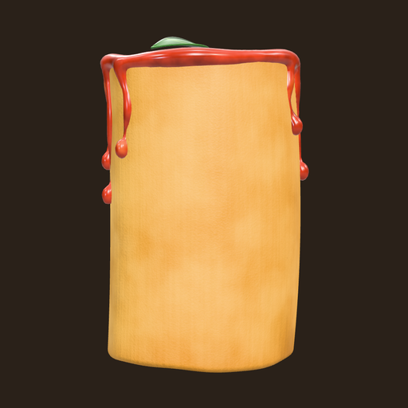
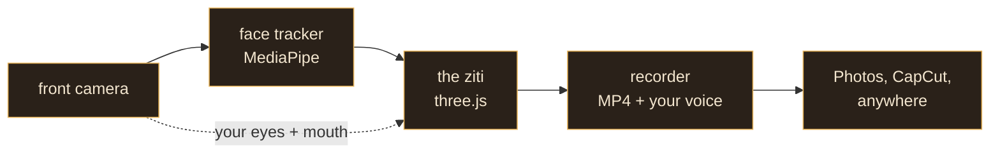

# ZitiCam Pocket

**Your real eyes and mouth, living on a noodle. Right on your phone.**

Record the live-face ziti on a key color, then drop it over anything.

### [Open ZitiCam Pocket](https://bkd-ziti.github.io/ziticam-pocket/)

---

## why a noodle

People don't remember a face cam. They remember a feeling, a character, a voice they can follow. The ziti is a face that's honest without being exposed: your actual eyes, your actual mouth, your actual timing, set into a piece of pasta that turns its head when you do.

ZitiCam started as a stream overlay on the PC. **ZitiCam Pocket** is the same noodle, same look, same tuning, running entirely in your phone's browser. Nothing to install, no account, no upload.

## how it works

Every frame, the tracker finds your face, the noodle copies your head turn, and your eyes and mouth get cut from that exact frame and wrapped onto the pasta. Talk and the noodle squashes a little with your jaw.

## make a clip

1. Open the link in **Safari** on your iPhone. Tap **Start camera** and allow camera + mic.
2. Hold the phone the way you'll record, look at it, tap **Set straight**.
3. Tap the big red button. 3, 2, 1, you're rolling.
4. Tap again to stop. Watch it back, then **Save / Share** → **Save Video** puts it in Photos.

> Tip: in Safari tap **Share** → **Add to Home Screen** and it opens like an app.

## drop it over anything

Clips record on a flat **blue** background. Not green on purpose: the basil on the noodle is green, and a green key would eat it.

In CapCut: add the clip as an overlay, open **Chroma key**, pick the blue, then raise the intensity until the edges are clean. The noodle is rendered on a perfectly flat color, so it keys cleaner than any real green screen.

Need a different key? Tap the color chip: **Blue → Green → Pink**.

## controls

| button | what it does |
| --- | --- |
| **Blue / Green / Pink** | key color behind the noodle |
| **Sauce** | red-sauce outfit on or off |
| **Set straight** | makes your current head pose "looking ahead" |
| **Look** | eye and mouth size + placement, head follow, drift, talk bounce, calm, frame size + height, eyebrows, flip, mirror, countdown, 720p / 1080p / 4K, 30 / 60 fps, mic clean / voice |
| **Stats** | frame rate against its budget, tracker speed, camera, mic level and recorder info |
| **Last take** | reopens your most recent take, including one kept from a session that closed or crashed |

Settings save on the phone. **Reset to stream look** brings back the stream PC's ZitiCam tuning.

## under the hood

- **Face tracking:** Google MediaPipe Face Landmarker 0.10.35, the same build as the stream PC, running in a background worker so a slow face check never holds up a video frame. 478 face points plus a jaw-open score; each answer comes back with the exact camera frame it measured, so the eyes and mouth never slide around. Served from this site, so it works offline after the first visit.
- **The noodle:** three.js r169 rendering `ziti.glb`, sauce and basil included. Only the noodle is anti-aliased: it's drawn sharp into its own image, sized to the box it fills on screen, then placed on the flat key color. Same look as before, far less graphics work per frame.
- **Staying smooth:** if the phone can't hold the frame rate, the noodle is redrawn every other frame at 60 fps, then drawn a touch softer. Each step is measured and undone if it didn't help, and steps back up when there's headroom.
- **Recording:** every drawn frame goes straight to the phone's hardware H.264 encoder with an exact timestamp ([Mediabunny](https://mediabunny.dev) writes the MP4), so takes are a true constant 30 or 60 fps. Up to 2160 × 3840 (4K). Older iPhones without that encoder fall back to Safari's built-in recorder, fed one frame per drawn frame.
- **Takes on disk:** takes are written to the site's private storage as they record, so long 4K takes don't have to fit in memory, and a take cut short by a crash is kept.
- **Clean audio:** the mic opens only while you record, with the iPhone's call-style processing switched off, so takes capture your voice as it is. It's recorded on the audio thread through one steady line, so drawing can never cause gaps, and a level meter in the timer shows sound is really arriving. Flip **Look → Mic → Voice** if you're somewhere loud.
- **Privacy:** your camera feed, your face and your takes stay on the phone. This site only hands your browser the files below.

## files

| file | what it is |
| --- | --- |
| `index.html` | the screen: camera view, buttons, sheets |
| `app.js` | tracking, the noodle, recording, controls |
| `tracker-worker.js` | the face tracker, off the main thread |
| `recorder-wc.js` | constant-frame-rate recorder (WebCodecs + Mediabunny) |
| `audio-tap.js` | collects the mic on the audio thread for the recorder |
| `take-writer.js` | writes takes to the site's private storage as they record |
| `sw.js` | offline support |
| `vendor/` | MediaPipe tasks-vision 0.10.35 and Mediabunny 1.65.2, unmodified |
| `ziti.glb` | the 3D ziti (v2, sauce + basil) |
| `face_landmarker.task` | MediaPipe face model |
| `three.module.min.js`, `GLTFLoader.js`, `RoomEnvironment.js`, `BufferGeometryUtils.js` | three.js r169 |
| `manifest.webmanifest`, `icon-180.png`, `icon-512.png` | home-screen app setup |

<b>URL flags for testing</b>

| flag | effect |
| --- | --- |
| `?debug=1` | stats on from the start |
| `?autostart=1` | skip the start screen |
| `?notrack=1` | run without the face tracker |
| `?mime=video/mp4` | force a recorder format |
| `?mp=<url>` | load MediaPipe from another location |
| `?track=page` | run the face tracker on the page instead of a worker |
| `?rec=mr` | use the browser's built-in recorder |
| `?memrec=1` | keep takes in memory instead of storage |

## what's next

- [x] **v0.1:** record on a key color, save to Photos
- [x] **v0.1.1:** cleaner, more consistent audio
- [x] **v0.2:** 4K and 60 fps, steady constant-frame-rate takes, saved to storage as you record, works offline after the first visit
- [ ] react mode: a clip from your camera roll plays behind the noodle while you record
- [ ] teleprompter only you can see, never in the video
- [ ] native iPhone app: film with the back camera while the noodle reacts in the corner

## credits

- [three.js](https://threejs.org), MIT license (see `licenses/three.js-LICENSE.txt`). That license covers three.js only.
- [MediaPipe](https://ai.google.dev/edge/mediapipe), Apache 2.0 (see `licenses/mediapipe-NOTICE.txt`)
- [Mediabunny](https://mediabunny.dev), MPL-2.0 (see `licenses/mediabunny-LICENSE.txt`)
- The ziti, its sauce and its basil: © BKDziti LLC

 
a <b>BKDziti</b> experiment · rethinking food, media, and interaction, online and in person

