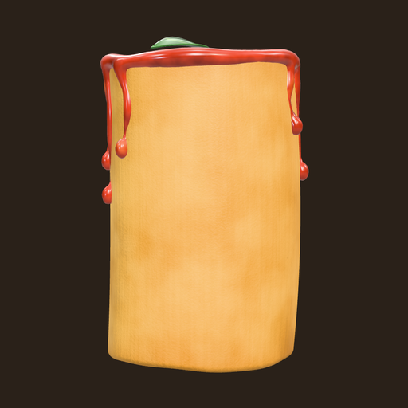
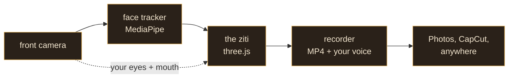

# ZitiCam Pocket

**Your real eyes and mouth, living on a noodle. Right on your phone.**

Record the live-face ziti on a key color, then drop it over anything.

### [Open ZitiCam Pocket](https://bkd-ziti.github.io/ziticam-pocket/)

---

## why a noodle

People don't remember a face cam. They remember a feeling, a character, a voice they can follow. The ziti is a face that's honest without being exposed: your actual eyes, your actual mouth, your actual timing, set into a piece of pasta that turns its head when you do.

ZitiCam started as a stream overlay on the PC. **ZitiCam Pocket** is the same noodle, same look, same tuning, running entirely in your phone's browser. Nothing to install, no account, no upload.

## how it works

Every frame, the tracker finds your face, the noodle copies your head turn, and your eyes and mouth get cut from that exact frame and wrapped onto the pasta. Talk and the noodle squashes a little with your jaw.

## make a clip

1. Open the link in **Safari** on your iPhone. Tap **Start camera** and allow camera + mic.
2. Hold the phone the way you'll record, look at it, tap **Set straight**.
3. Tap the big red button. 3, 2, 1, you're rolling.
4. Tap again to stop. Watch it back, then **Save / Share** → **Save Video** puts it in Photos.

> Tip: in Safari tap **Share** → **Add to Home Screen** and it opens like an app.

## drop it over anything

Clips record on a flat **blue** background. Not green on purpose: the basil on the noodle is green, and a green key would eat it.

In CapCut: add the clip as an overlay, open **Chroma key**, pick the blue, then raise the intensity until the edges are clean. The noodle is rendered on a perfectly flat color, so it keys cleaner than any real green screen.

Need a different key? Tap the color chip: **Blue → Green → Pink**.

## controls

| button | what it does |
| --- | --- |
| **Blue / Green / Pink** | key color behind the noodle |
| **Sauce** | red-sauce outfit on or off |
| **Set straight** | makes your current head pose "looking ahead" |
| **Look** | eye and mouth size + placement, head follow, drift, talk bounce, calm, frame size + height, eyebrows, flip, mirror, countdown, 720 / 1080 |
| **Stats** | frame rate, tracker speed, camera and recorder info |

Settings save on the phone. **Reset to stream look** brings back the stream PC's ZitiCam tuning.

## under the hood

- **Face tracking:** Google MediaPipe Face Landmarker 0.10.35, the same build as the stream PC. 478 face points plus a jaw-open score, every frame, on the phone's GPU.
- **The noodle:** three.js r169 rendering `ziti.glb`, sauce and basil included. Eyes and mouth are sampled from the exact camera frame the tracker saw, so they never slide around.
- **Recording:** the 3D canvas plus your mic go through Safari's built-in recorder to MP4 (H.264 + AAC), vertical 1080 × 1920 at 30 fps.
- **Privacy:** your camera feed, your face and your takes stay on the phone. This site only hands your browser the files below.

## files

| file | what it is |
| --- | --- |
| `index.html` | the screen: camera view, buttons, sheets |
| `app.js` | tracking, the noodle, recording, controls |
| `ziti.glb` | the 3D ziti (v2, sauce + basil) |
| `face_landmarker.task` | MediaPipe face model |
| `three.module.min.js`, `GLTFLoader.js`, `RoomEnvironment.js`, `BufferGeometryUtils.js` | three.js r169 |
| `manifest.webmanifest`, `icon-180.png`, `icon-512.png` | home-screen app setup |

<b>URL flags for testing</b>

| flag | effect |
| --- | --- |
| `?debug=1` | stats on from the start |
| `?autostart=1` | skip the start screen |
| `?notrack=1` | run without the face tracker |
| `?mime=video/mp4` | force a recorder format |
| `?mp=<url>` | load MediaPipe from another location |

## what's next

- [x] **v0.1:** record on a key color, save to Photos
- [ ] works offline after the first visit
- [ ] react mode: a clip from your camera roll plays behind the noodle while you record
- [ ] teleprompter only you can see, never in the video
- [ ] native iPhone app: film with the back camera while the noodle reacts in the corner

## credits

- [three.js](https://threejs.org), MIT license (see `licenses/three.js-LICENSE.txt`). That license covers three.js only.
- [MediaPipe](https://ai.google.dev/edge/mediapipe), Apache 2.0
- The ziti, its sauce and its basil: © BKDziti LLC

 
a <b>BKDziti</b> experiment · rethinking food, media, and interaction, online and in person

